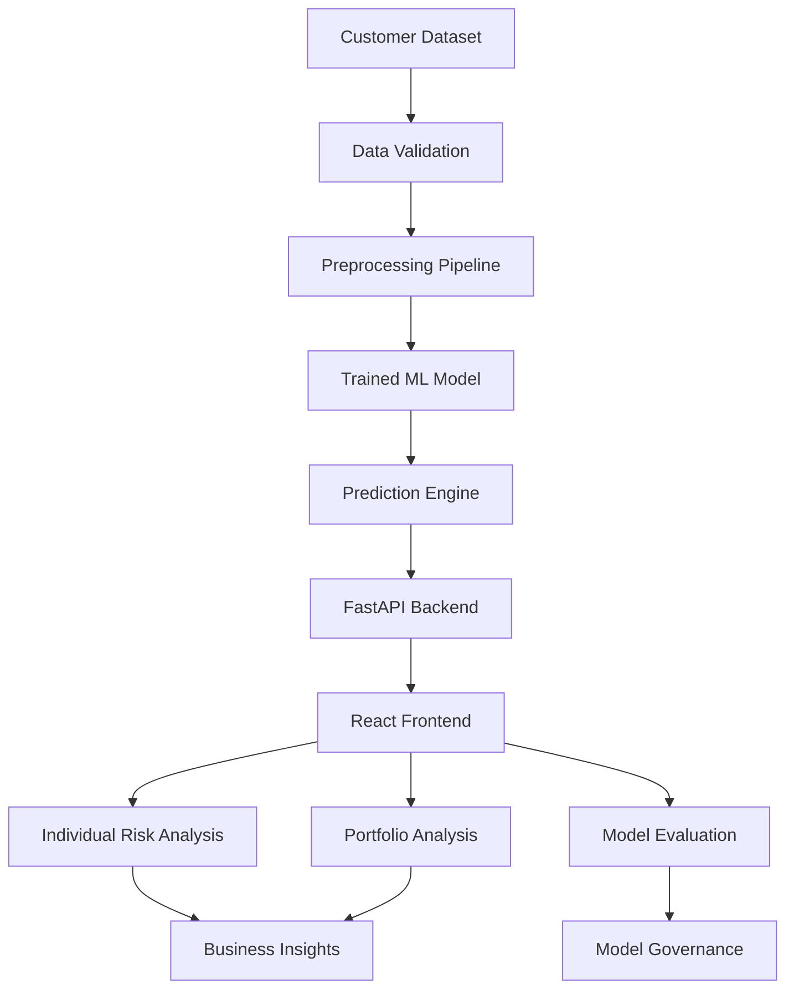

# Attritex
### Customer Retention & Revenue Intelligence Platform

**Turning customer churn predictions into actionable business insights.**

Attritex is a machine learning and business intelligence platform designed to help businesses understand customer churn, identify high-risk accounts, and estimate the revenue potentially exposed to customer loss.

Rather than stopping at a simple prediction, Attritex connects machine learning outputs with financial indicators and interpretable risk factors, giving customer success and retention teams a clearer picture of their customer portfolio.

---

## Overview

Customer churn is more than a classification problem. When customers leave, businesses lose recurring revenue, and understanding where that risk comes from is essential for making better retention decisions.

Attritex addresses this through three main workflows:

- **Individual analysis:** Evaluate the churn risk of a customer and understand the factors contributing to the prediction.
- **Portfolio analysis:** Score large customer datasets, identify risk patterns, and quantify estimated revenue exposure.
- **Model evaluation:** Examine predictive performance, compare models against baselines, and assess statistical uncertainty.

The goal is to make machine learning results understandable and useful beyond the data science workflow.

## Key Features

### 1. Individual Customer Risk Profiling

Evaluate individual customer records through an interactive prediction interface.

- Structured customer information grouped into account and contract, services, and demographics and billing.
- Quick presets for high-risk customers, loyal customers, and typical users.
- Churn probability and risk classification.
- Local model-based risk indicators highlighting factors that increase or reduce the predicted risk.
- Estimated annualized revenue exposure.

The financial exposure calculation is:

\[
\text{Expected ARR at Risk}
=
\text{Monthly Charges} \times 12 \times \text{Churn Probability}
\]

This provides an estimate of revenue exposure, not a guaranteed financial loss.

### 2. Portfolio Batch Analysis

Analyze customer portfolios without scoring records individually.

- CSV ingestion supporting up to 50,000 customer records.
- Row-level validation with valid and invalid record reporting.
- Aggregate portfolio statistics.
- Predicted churn rate compared with the dataset's empirical 26.5% base rate.
- Total estimated ARR at risk.
- Export enriched customer records with predictions, risk tiers, and revenue exposure.

### 3. Model Evaluation & Governance

Model performance is evaluated using multiple complementary metrics rather than relying on accuracy alone.

The evaluation workflow includes:

- Candidate model comparison and cross-validation.
- Stratified random baseline benchmarking.
- ROC curves and ROC-AUC.
- Precision-Recall curves and PR-AUC.
- Calibration diagrams.
- 95% bootstrap confidence intervals.
- Permutation feature importance.
- Feature specifications and data dictionary.

Evaluation also includes explicit attention to the difference between statistical associations and individual-level causation.

## Model Performance

Reported evaluation results for the current model:

| Metric | Result |
|---|---:|
| ROC-AUC | 0.8421 |
| PR-AUC | 0.6342 |
| Empirical churn base rate | 26.5% |
| Bootstrap confidence intervals | 95% |

The application also provides comparisons against a stratified random baseline and candidate tree-based models.

These figures describe the reported evaluation results; they should be interpreted in the context of the dataset, validation methodology, and class distribution.

## Technology Stack

| Layer | Technologies |
|---|---|
| Backend | Python 3.11, FastAPI, Pydantic V2, Uvicorn |
| Machine Learning | scikit-learn, Pandas, NumPy, Joblib |
| Frontend | React 19, TypeScript, Vite |
| Styling | Tailwind CSS |
| Visualization | Recharts, Lucide React |
| Environment | uv |
| Infrastructure | Docker, Docker Compose, Nginx |

## Architecture

Attritex follows a modular architecture separating the prediction pipeline, API, and user interface.



### Backend

The FastAPI backend handles:

- Request validation through Pydantic.
- Individual customer predictions.
- Batch CSV processing.
- Model evaluation information.
- Centralized API error handling.

The machine learning components are separated into dedicated modules for training, evaluation, and explanations.

### Machine Learning Pipeline

The pipeline uses scikit-learn to manage preprocessing and model training.

Its responsibilities include:

- Missing-value handling, including zero-tenure imputation.
- Categorical feature encoding through one-hot encoding.
- Numerical feature scaling.
- Candidate model training and comparison.
- Reproducible model serialization with Joblib.
- Prediction and evaluation.

### Frontend

The React application provides separate workflows for individual predictions, batch portfolio analysis, and model evaluation.

Interactive visualizations help users understand risk distributions, model performance, calibration, and local prediction factors.

## Project Structure

The application is organized into separate backend and frontend components.

```text
Attritex/
├── backend/
│   ├── attritex/
│   │   └── api/
│   │       └── app.py
│   └── tests/
│
├── frontend/
│   └── src/
│       └── App.tsx
│
├── docker-compose.yml
└── README.md
```

The backend package contains the ML pipeline, API, evaluation, and explanation components. The frontend contains the customer analysis and visualization interfaces.

## Getting Started

### Prerequisites

- Python 3.11
- uv
- Node.js and npm
- Docker and Docker Compose (for containerized execution)

### Backend

From the project root:

```bash
uv run attritex --help
```

This displays the available CLI commands for data fetching, model training, and server execution.

The backend API is configured for:

```text
http://127.0.0.1:8000
```

### Frontend

The frontend is located in:

```text
frontend/
```

Use the package scripts defined in its `package.json` to install dependencies and start the Vite development server.

The development interface is configured for:

```text
http://127.0.0.1:5173
```

### Tests

Run the backend test suite:

```bash
uv run pytest
```

**Current test status:** 44 tests passing.

Refer to the project configuration and CLI help for the complete data preparation and model training workflow.

## Design Philosophy

Attritex uses a restrained interface designed around data clarity and business decision-making.

The visual identity combines:

- Ink: `#1B242D`
- Terracotta: `#D65A31`

The interface prioritizes readable information, meaningful visualizations, and clear separation between customer-level predictions and portfolio-level analysis.

## Important Considerations

Attritex is a predictive decision-support tool, not an automated retention decision system.

- A churn probability is an estimate, not certainty.
- Feature attribution indicates model associations, not proof of causation.
- Estimated revenue exposure should not be interpreted as guaranteed financial loss.
- Model performance depends on data quality, representativeness, and validation methodology.
- Predictions should support human judgment rather than replace it.

## About

Attritex is a personal portfolio project developed as part of my exploration of applied machine learning, data science, and business intelligence.

I wanted to work on something that connects the technical side of machine learning with a real business question: how can we identify customer risk and make that information useful for business decisions?

The project brings together data preprocessing, predictive modeling, statistical evaluation, backend engineering, and interactive data visualization in one application.

**Built with Python, scikit-learn, FastAPI, React, and TypeScript.**
