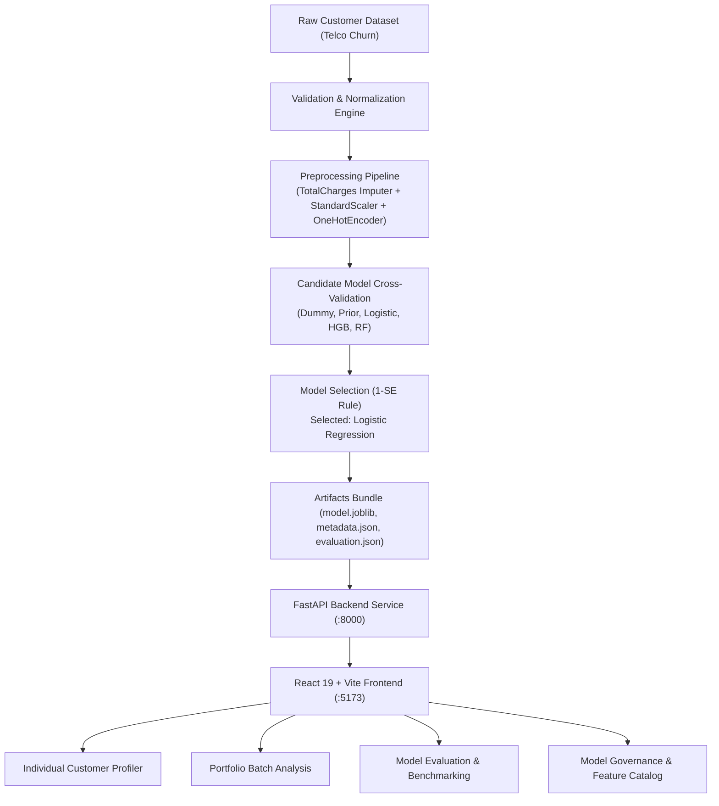

<p align="center">
  
</p>

<p align="center">
  <strong>Customer Retention & Revenue Intelligence Platform</strong><br />
  <em>Turning customer churn predictions into actionable business insights and quantifiable ARR protection.</em>
</p>

<p align="center">
  
  
  
  
  
  
  
  
</p>

---

## Overview

Customer churn is more than a binary classification problem. When customers leave, businesses lose recurring revenue, and understanding where that risk comes from is essential for making better retention decisions.

**Attritex** is an end-to-end machine learning and business intelligence platform designed to help businesses understand customer churn, identify high-risk accounts, and estimate the financial revenue exposed to customer loss. Rather than presenting an isolated model in a notebook, Attritex connects reproducible machine learning pipelines with financial risk indicators and local explainability drivers, giving commercial teams and customer success managers an intuitive, defensible decision platform.

Attritex addresses retention through three core workflows:

- **Individual Customer Risk Profiler:** Score individual customer records, calculate expected ARR at risk, and inspect localized risk factors.
- **Portfolio Batch Analysis:** Process bulk customer portfolios, identify risk distributions against baseline rates, and export enriched datasets.
- **Model Evaluation & Governance:** Inspect predictive performance, benchmark candidate models against stratified random baselines, examine calibration, and assess statistical uncertainty.

---

## Key Features

### 1. Individual Customer Risk Profiling

Evaluate individual accounts through an interactive, responsive 3-column prediction interface:

- **Structured Input Grouping:** Categorized into *Account & Contract*, *Services*, and *Demographics & Billing*.
- **Interactive Presets:** Instant loading of real-world scenarios (*High Risk*, *Loyal Customer*, *Typical User*).
- **Calibrated Churn Probability:** Probability output paired with screening cutoffs (Low, Medium, High risk tiers).
- **Local Explainability Drivers:** Top 3 risk-increasing and top 2 risk-reducing features calculated via model coefficients relative to population medians.
- **Quantified Revenue Exposure:** Computes expected annualized financial risk:

$$\text{Expected ARR at Risk} = \text{MonthlyCharges} \times 12 \times \text{churn\_probability}$$

> *Note: Local attribution describes relative probability shift; it does not establish individual causation.*

### 2. Portfolio Batch Analysis

Analyze entire customer cohorts without scoring records manually:

- **High-Capacity CSV Ingestion:** Upload CSV portfolios of up to 50,000 customer records with streaming validation.
- **Row-Level Schema Validation:** Clear error reporting distinguishing valid records from invalid entries.
- **Portfolio Health KPIs:**
  - **Total Records Scored** (valid vs. invalid rows).
  - **Predicted Portfolio Churn Rate** compared against the empirical 26.5% base rate.
  - **Total ARR at Risk** aggregated across the portfolio.
- **Probability Histogram:** 20-bin probability density distribution visualizer.
- **Enriched CSV Export:** Download scored datasets with probabilities, risk tiers, and calculated ARR exposure.
- **Template Download:** Built-in template endpoint (`GET /api/predict/batch/template`) providing sample CSV structure.

### 3. Model Evaluation & Governance

Performance evaluated across multiple complementary dimensions rather than raw accuracy:

- **Strict ROC Curves:** Monotonically sorted coordinate pairs bounded to `[0, 1]` with a 45° random classifier benchmark line.
- **Candidate Model Comparison:** Cross-validation across multiple algorithms (*Dummy Stratified Baseline*, *Prior Baseline*, *Logistic Regression L2*, *Balanced Logistic Regression*, *HistGradientBoosting*, and *Random Forest*).
- **Parsimony Rule:** Automatic selection of the simplest model within 1 standard error of the top candidate (Logistic Regression selected for superior calibration and direct coefficient interpretability).
- **Holdout Confidence Intervals:** 95% bootstrap intervals across ROC-AUC, PR-AUC, and optimal F1 score.
- **Calibration Curves & Brier Score:** Direct reliability assessment preventing overconfident probability outputs.
- **Permutation Importance:** Empirical feature importance ranked by impact on model performance.
- **Data Governance & Dictionary:** Feature catalog, training provenance, and model versioning tracking.

---

## Model Performance

Reported holdout evaluation results for the production model:

| Metric | Result | Benchmark Context |
| :--- | :---:| :--- |
| **ROC-AUC** | **0.8421** | +0.3421 net lift over Stratified Baseline (0.5000) |
| **PR-AUC** | **0.6342** | +0.3688 net lift over empirical base rate (0.2654) |
| **Precision** | **53.98%** | At decision threshold (0.3262) |
| **Recall** | **72.46%** | Captures ~72.5% of all holdout churners |
| **F1 Score** | **0.6187** | Balanced harmonic mean at screening cutoff |
| **Brier Score** | **0.1345** | Demonstrates well-calibrated posterior probabilities |
| **Confidence Intervals** | **95%** | Derived via 1,000 bootstrap resamples |

---

## Technology Stack

| Layer | Technologies | Description |
| :--- | :--- | :--- |
| **Backend API** | Python 3.11, FastAPI, Pydantic V2, Uvicorn | Strict schema validation, asynchronous batch processing, and centralized error handling. |
| **Machine Learning** | scikit-learn, Pandas, NumPy, Joblib | Zero-tenure imputation, one-hot encoding, feature scaling, model selection, and artifacts serialization. |
| **Frontend UI** | React 19, TypeScript, Vite | Modular single-page application with type safety and state management. |
| **Styling** | Tailwind CSS | Custom design token system (Dark Ink `#1B242D`, Terracotta `#D65A31`, Canvas `#F8F6F0`). |
| **Visualization** | Recharts, Lucide React | Interactive ROC/PR curves, histograms, and horizontal attribution charts. |
| **Packaging & Env** | uv, Hatchling | Ultra-fast Python package resolution and virtual environment management. |
| **Infrastructure** | Docker, Docker Compose, Nginx | Multi-stage production container builds and reverse-proxy routing. |

---

## Architecture

Attritex follows a clean, modular architecture separating the data processing pipeline, prediction engine, REST API, and user interface.



---

## Project Structure

```text
Attritex/
├── artifacts/                           # Serialized model, metadata, and evaluation metrics
│   ├── evaluation.json
│   ├── metadata.json
│   └── model.joblib
├── backend/                             # FastAPI application & ML pipeline
│   ├── attritex/
│   │   ├── api/                         # Endpoints, schemas, error handlers, dependencies
│   │   │   ├── routes/
│   │   │   │   ├── model.py             # Evaluation & metadata routes
│   │   │   │   └── predictions.py       # Single & batch prediction routes
│   │   │   ├── app.py                   # FastAPI application factory
│   │   │   ├── errors.py                # Exception handlers & standard error response
│   │   │   └── schemas.py               # Pydantic V2 request & response schemas
│   │   ├── data/                        # Ingestion, validation, synthetic fixtures
│   │   │   ├── fixture.py
│   │   │   ├── loading.py
│   │   │   ├── schema.py
│   │   │   └── validation.py
│   │   ├── ml/                          # Core machine learning & explainability
│   │   │   ├── artifacts.py             # Model bundle loading & verification
│   │   │   ├── candidates.py            # Model candidate definitions
│   │   │   ├── evaluation.py            # ROC, PR, Brier, bootstrap calculations
│   │   │   ├── explanations.py          # Local feature attribution engine
│   │   │   ├── inference.py             # Single & batch scoring orchestration
│   │   │   ├── preprocessing.py         # Custom transformers & pipelines
│   │   │   ├── thresholds.py            # Decision threshold & tier cutoffs
│   │   │   └── training.py              # Cross-validation & model training
│   │   ├── cli.py                       # CLI entry point (attritex data/train/serve)
│   │   └── config.py                    # Environment settings
│   ├── tests/                           # 44 comprehensive pytest tests
│   ├── Dockerfile
│   └── pyproject.toml
├── frontend/                            # React 19 + TypeScript frontend
│   ├── public/                          # Static brand assets & favicon
│   │   ├── attritex-icon.png
│   │   ├── attritex-logo.png
│   │   └── favicon.png
│   ├── src/
│   │   ├── components/
│   │   │   ├── BatchPrediction.tsx      # Portfolio batch analysis view
│   │   │   ├── Header.tsx               # Navigation & live model status badge
│   │   │   ├── Logo.tsx                 # Brand logo component
│   │   │   ├── MetricCard.tsx           # Stat metric display cards
│   │   │   ├── ModelEvaluationView.tsx  # ROC/PR charts & baseline comparison
│   │   │   ├── ModelGovernanceView.tsx  # Feature catalog & data dictionary
│   │   │   └── SinglePrediction.tsx     # 3-column customer profiler
│   │   ├── App.tsx                      # Root application layout & state
│   │   ├── api.ts                       # Typed API client
│   │   └── types.ts                     # TypeScript definitions
│   ├── Dockerfile
│   ├── nginx.conf
│   └── package.json
├── data/                                # Dataset storage & provenance
├── docker-compose.yml                   # Multi-container orchestration
└── README.md
```

---

## API Reference

The backend exposes a fully typed REST API with interactive Swagger documentation available at `/docs`:

| Method | Endpoint | Description |
| :--- | :--- | :--- |
| `GET` | `/api/health` | Returns service health, model load status, and active model version. |
| `GET` | `/api/model` | Returns model metadata, features dictionary, and training configuration. |
| `GET` | `/api/model/evaluation` | Returns holdout metrics, sorted ROC/PR coordinates, and baseline comparisons. |
| `POST` | `/api/predict` | Computes churn probability, ARR at risk, risk tier, and local attributions. |
| `POST` | `/api/predict/batch` | Processes uploaded CSV, returning JSON summary or scored CSV (`?format=csv`). |
| `GET` | `/api/predict/batch/template` | Downloads an exemplary CSV template with all required feature headers. |

---

## Getting Started

### Prerequisites

- **Python 3.11+**
- **uv** (recommended) or `pip`
- **Node.js 18+** and `npm`
- **Docker & Docker Compose** (optional, for containerized run)

### 1. Local Development Setup

#### Backend Setup

Clone the repository and install backend dependencies using `uv`:

```bash
git clone https://github.com/EzzedineYassine/Attritex.git
cd Attritex/backend

# Synchronize virtual environment
uv sync

# Fetch training data (or generate synthetic fixture)
uv run attritex data

# Train the model and serialize artifacts
uv run attritex train

# Start the FastAPI server
uv run attritex serve --host 127.0.0.1 --port 8000
```

The API will be live at `http://127.0.0.1:8000` (docs at `http://127.0.0.1:8000/docs`).

#### Frontend Setup

In a new terminal:

```bash
cd Attritex/frontend

# Install dependencies
npm install

# Start the Vite development server
npm run dev
```

The UI will be accessible at `http://127.0.0.1:5173`.

---

### 2. Running with Docker Compose

To launch the complete application stack (Backend API + Frontend Nginx) in containers:

```bash
docker-compose up --build
```

- **Frontend:** `http://localhost:3000`
- **Backend API:** `http://localhost:8000`

---

### 3. Running Tests & Linters

Execute the full backend test suite:

```bash
cd backend
uv run pytest
```

Execute code style and linting checks:

```bash
uv run ruff check .
```

Verify the frontend build and type checking:

```bash
cd frontend
npm run build
```

---

## Design Philosophy

Attritex uses a restrained, functional interface designed around data clarity and executive decision-making.

- **Color System:** Dark Ink (`#1B242D`) conveys stability and enterprise rigor, balanced by Terracotta (`#D65A31`) for risk highlights and Warm Ivory (`#F8F6F0`) to reduce visual fatigue.
- **Micro-Copy Integrity:** Statistical estimates are explicitly decoupled from causal claims across all views.
- **Hierarchical Layout:** High-level executive numbers sit above detailed distribution charts, followed by granular row-level inspection.

---

## Important Considerations

Attritex is an analytical decision-support system, not an autonomous retention automation tool.

- **Statistical Estimates:** Churn probabilities reflect historical population likelihoods, not guaranteed individual behavior.
- **Correlation vs. Causation:** Local feature attributions indicate directional probability shifts within the model; they do not establish individual-level causation.
- **Revenue Exposure:** Estimated ARR at risk quantifies financial exposure under default behavior; actual salvageable revenue depends on intervention strategy and customer unit economics.
- **Model Monitoring:** Model outputs must be periodically reassessed against incoming cohort actuals to guard against distribution shift and feature drift.

---

## About

**Attritex** was developed by **Yassine Ezzedine** as a comprehensive machine learning and software engineering portfolio project.

The goal of this project is to demonstrate end-to-end craftsmanship: connecting statistical modeling, defensible validation methodology, robust backend engineering, and intuitive data visualization into a unified, production-grade business product.

**Built with Python, scikit-learn, FastAPI, React, and TypeScript.**
